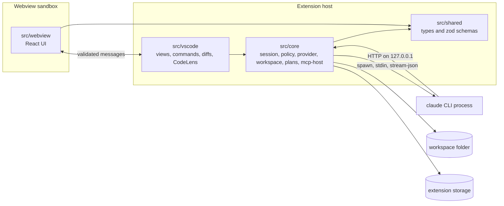
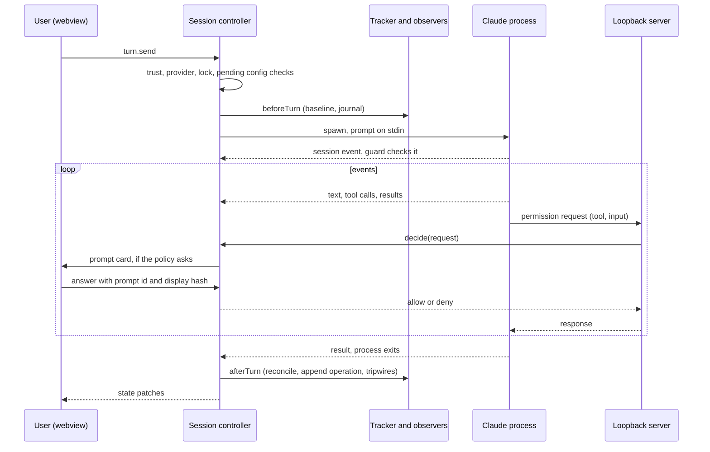

# Architecture

This page explains how AgentCanopy is put together, for people who want to change it. It describes the code as it is. [CONTRIBUTING.md](../CONTRIBUTING.md) has the commands, and `docs/protocol/claude-cli.md` has the observed behavior of the Claude Code CLI that the design rests on.

## Layers

AgentCanopy does not use an SDK. It starts the user's own `claude` executable once per user turn, in print mode with a streaming JSON output, and reads its events.

- `src/shared` holds domain types and zod schemas: events, view state, the webview protocol, plans, settings.
- `src/core` is the application and imports neither `vscode` nor React. Everything it needs from the editor comes through ports in `src/core/contracts`: environment (folders, trust, settings, storage), a UI port (native dialogs, diffs, links), an editor port (dirty buffers, saves), a clock and a logger. The core uses Node's file system and process APIs directly, and tests point it at temporary folders and at a fake CLI. This is why almost everything is tested without VS Code.
- `src/vscode` implements those ports and registers views, commands, CodeLens, decorations and virtual documents (read-only plan documents, plan versions and review baselines for the diff editor).
- `src/webview` is the UI. It imports only `src/shared`. It holds no state of its own beyond what the host sends and some view-only state such as drafts and expanded rows.

ESLint enforces the import rules.

## The Claude adapter

`src/core/provider/claude` has three parts: `detect` (find the executable through absolute paths only and probe it from the home folder, then its version, sign-in state, whether `--resume-session-at` is accepted), `process` (build the arguments, write per-turn files, spawn, frame output, cancel, track orphans) and `events` (map raw CLI output to provider-neutral events).

Every turn runs `claude -p --output-format stream-json --verbose --include-partial-messages --include-hook-events --permission-mode default` with a permission prompt tool pointing at the loopback server, an MCP config, a settings file and a system prompt file, plus a session flag. The prompt goes on stdin. The config files are created exclusively with owner-only permissions in a per-turn directory that is deleted afterwards. The child gets the user's environment without VS Code's and nesting markers, and with background tasks disabled.

| Mode | Tools and settings | Host policy |
| :- | :- | :- |
| Ask | `--tools Read,Grep,Glob,AskUserQuestion`, strict MCP config, no slash commands, hooks disabled | Default deny; reads inside the folder pass, reads outside ask |
| Plan | Ask, plus the plan tool unless the plan is locked | Same as Ask |
| Agent | Default tools, `ask` rules for the edit tools, saved allow rules, tool hooks, optional sandbox | Edits inside the folder pass; protected paths, outside paths, commands, web and external tools ask, except what Auto approves (see Permission flow) |

## Turn flow

1. The controller checks trust, provider readiness, the folder lock and that no configuration change awaits a decision (an Agent send meeting one is refused with a toast before anything is recorded; the composer disables it first). A send in a conversation whose turn is still running does not reach the steps below: see [Sending while a turn runs](#sending-while-a-turn-runs). Before the process starts, the project configuration gate (`src/core/policy/project-config`) inspects `.claude/settings.json`, `.claude/settings.local.json` and `.mcp.json` in the folder and at its Git root. If they can run programs or change the environment, a native dialog asks whether to ignore them; the answer is stored per folder and pinned to a fingerprint of the files. Ignoring adds `--setting-sources user` (which also drops the project's `CLAUDE.md`) and `--strict-mcp-config` to the invocation.
2. It composes the prompt: a tagged block with the mode, the plan, attachments and a note about files reverted since the last turn, then your text exactly as typed.
3. Observers run `beforeTurn`. In Agent mode the tracker waits for the folder baseline, records foreign changes since the last operation and journals the turn (phases, process id and start time) before the process exists.
4. The process starts. Events stream into host state. The turn ends when the process exits, not at the first `result`.
5. At the end, observers run `afterTurn`: the tracker reconciles what changed, appends an operation to the log and runs the Git-state and configuration checks; the read-only tripwire compares file metadata.
6. On the next activation, a journaled open turn means a crash. The orphaned process is stopped first, then the folder is reconciled and the changes are marked as after an interruption.

Cancel sends SIGINT, then settles pending prompts, then SIGTERM and SIGKILL to the process group after grace periods. Windows uses `taskkill /T /F`.

## Sending while a turn runs

The CLI reads its prompt once and stdin is closed after it, so a running turn cannot be given more. Runs are keyed by conversation, so a second run in another conversation can go on at the same time. The controller treats a `turn.send` on a conversation that has a run in three ways.

- **Agent or Plan: a queue.** The controller keeps one queued message per conversation in memory (text, mode, model and a snapshot of the draft's attachments, with image bytes held by id). It is shown through `active.queued` and handled by `queue.edit`, `queue.remove` and `queue.sendNow`. The run's end hook sends it through `sendTurn` after the run has been removed, and only when the turn completed. It stays after a stop or an error, whatever its mode; an Agent message also stays, and is not sent later by itself, while configuration changes are pending or another Agent turn runs in the folder, and a Plan message does not. The host sends a queued message only when its own conversation's turn ends as completed, or on the user's Send. Send now cancels the run, waits for it to end and then sends; it does not cancel when a queued Agent message could not be sent afterwards for one of those two reasons, and warns instead.
- **Ask: a side question.** The controller forks the conversation at the running turn's user message, which keeps only the finished turns, without opening it, and marks the branch with `ConversationMeta.aside` (parent id and an anchor: the message and how many of its parts existed). It then starts the Ask turn in the branch through `sendTurn`. Ask is read-only and not subject to the folder lock, so it runs next to the parent. Because the parent is running, `planFork` rebuilds the transcript in a new session: the branch knows the conversation up to the last finished turn. The parent's run, transcript, session and records are not touched. If no run starts, the branch is deleted again. One side question per conversation runs at a time, and a side question cannot have one of its own.
- **The view.** Each stored branch whose `aside.parentId` is the open conversation is projected into `active.asides` (question, assistant parts, prompts, status). While the parent is loaded, every change of the branch's runtime is forwarded to the parent's entry through `state.mutate`, with streamed text as one `appendText` on the aside's path, so every view showing the parent follows; the list is rebuilt from the stored branches when a conversation is opened. The webview renders each entry as a card in the log at its anchor, with the same part renderers as the transcript.

## The event model

The adapter turns raw output into a small union of events (`src/shared/events.ts`): `session`, `status`, `text-delta`, `assistant-block`, `tool-call`, `tool-result`, `hook`, `rate-limit`, `retry`, `error`, `result` and `unknown`. Every event is validated on the way in; unknown shapes become `unknown`, not errors. Policies see every event through `inspect`, which can end the turn (the read-only guard) or attach a notice.

The controller folds events into conversation state: messages with parts (text, thinking, tool calls, prompts, plan updates), turns and their status. Conversations are append-only JSONL files with compaction, so a crash does not lose a pending prompt.

The host is the source of truth for what the UI shows. It sends the webview a full view state when the view is ready and after that sequence-numbered patches; a view that sees a gap asks for a resync. A prompt is a small state machine (pending, then answered, expired or cancelled), and the first valid answer wins across views.

## Permission flow

Claude Code asks the host about a tool call through the permission prompt tool, which is exposed by the loopback server as an MCP tool the model itself cannot see. The request arrives as `{tool_name, input, tool_use_id}`.

1. The server checks the route, the bearer token, the `Host` header and the absence of `Origin`, and hands the request to the turn's handlers.
2. The controller calls the mode's policy (`src/core/policy/readonly` or `agent`). A request naming one of AgentCanopy's own tools is denied. A request with no matching tool call in the stream gets no capture and no UI.
3. The policy returns allow or deny, or asks. To ask, it describes a prompt (title, full detail, choices, an optional always-allow rule). The controller adds an id and a hash of what is displayed, and the webview renders a card.
4. The answer must carry the same id and hash. Choosing **Always allow** opens a native dialog first; if it is declined, the answer becomes allow once.
5. The response goes back to Claude Code. A request whose connection closed is marked expired, and a late answer does nothing.

The settings file AgentCanopy writes for each turn adds `ask` rules, so Claude Code's own classification cannot approve a call first: in Agent mode for the edit tools, `Bash`, `PowerShell`, `Read`, `Grep`, `Glob`, `WebFetch` and `WebSearch`; in Ask and Plan for `Read`, `Grep`, `Glob` and the web tools when enabled. Saved always-allow rules are decided by the policy itself. In Agent mode `PreToolUse` and `PostToolUse` HTTP hooks bracket every tool call, so a change made inside a command's window is attributed to that command. Calls to other tools that your own Claude Code settings pre-approve can still skip this path. `Monitor` and `Skill` are named in the Agent `ask` rules too: Claude Code asks for them by default, and naming them makes that the host's decision. Tools Claude Code runs without asking never reach the policy.

Agent mode's Auto is a change to the Agent policy and nothing else in this flow. `ConversationMeta.agentAuto` holds the flag; the host keeps a set of conversations that were turned off but could not be saved, and one function (`autoOn` in the session controller) answers for the whole host. Whether a turn has Auto is decided once per send, where the execution profile is built, and can only be taken away afterwards: the policy reads it live (`PolicyContext.auto`), so turning Auto off, or the setting off, applies from the next request of a running turn. With Auto applying, the policy approves with source `auto` terminal commands, edits inside the folder when `editApproval` is `ask`, and web tools only with `agentCanopy.agent.auto.webTools`. A stored always-allow rule is checked first and approves as `user`. A command that carries `dangerouslyDisableSandbox`, protected paths, anything outside the folder, MCP and other tools are never approved by Auto. When the turn starts with Auto and the sandbox is configured, the settings file sets `sandbox.allowUnsandboxedCommands: false`, so a command cannot leave the sandbox in that turn; otherwise only `enabled` and `autoAllowBashIfSandboxed: false` are set. Turning Auto on goes through a native dialog and is checked again after it.

## The workspace log and what derives from it

`src/core/workspace` has four parts.

- `store`: a scanner that walks the folder under ignore rules, an index of per-file metadata (size, timestamps in nanoseconds, inode, mode), a content-addressed blob store (gzip, sha256, verified on every read), the append-only log and garbage collection.
- `tracker`: the turn journal, capture of a file before each file-tool edit, attribution of each change (agent tool, agent command, unattributed, user, mixed, external, after interruption), crash recovery, the folder lock and the configuration and Git watchers.
- `review`: a pure fold over the log that yields review entries, hunks, accept, reject, three-way merge and the restore executor.
- `checkpoints`: restore planning, the restore service and retention over the same log.

The log is one append-only file per workspace folder with three kinds of record: an **operation** (an agent turn, a reject, a restore or a recovery, with per-path before and after states), a **foreign delta** (a difference between the disk and the last operation's after-state, made by the user or another program) and a **review decision** (an accept). Only operations advance the recorded state of a file. Review state is derived: the pending diff of a file is its baseline against the current content, and accepting moves the baseline. Rejecting restores the baseline only when the file still equals the last operation's after-state; otherwise the user chooses.

Checkpoints are derived from the same log. Restoring to before step K (`analyze` in `checkpoints/plan.ts`) works out, per path, the state before the earliest change at or after K, and whether anything uncertain touched the path since. The preview puts each path in a group: restorable, restorable after a decision (changed since the last recorded state, or changes that were not the agent's), or not restorable (unsaved editor, content not kept, blocked path). Paths that wait for each other's deletion are tied and restored together. The preview carries a token over the log and the disk, and a restore rebuilds the plan and refuses if the token differs. Every write by the review and restore code goes through one executor: planned, preflighted (blockers, conflicts, free space), safety copy, temporary file and rename, verified, with parents re-checked and symbolic links refused. A restore is itself an operation with `restoredTo` set, so it appears in the history, and the fold uses it to bring review entries back when the restore is undone. Retention (`checkpoints/prune.ts`) cuts the log at an operation, and only where the review state folds to the same result, never past an operation a review entry is made of or past the last agent turn. A purge command in the tracker empties the log, the index and the blob store of one folder when nothing is running.

Path identity comes from the file system (device, inode, on-disk name), not from case folding or Unicode normalization.

## Plans and forks

A plan is a stored document of immutable versions. Its zod schema, converted to JSON Schema, is the input of the plan tool. User decisions are held by the host and keyed by stable ids so that they carry across versions. Approval records the version and content hash before the execution turn is spawned.

A branch is a conversation with a parent, a fork point and the parent's id of the last turn it keeps. A side question is a branch too, made by the controller instead of the user. `ConversationStore.fork` copies the kept turns and messages and marks the branch `pending`. The strategy is chosen at the last moment, in `planFork` in `src/core/session/turn.ts`, because the parent can change while the first turn prepares. The parent is held (it cannot start a turn) while a copy of its session is made. The choices are: copy the whole session with `--fork-session` when the branch keeps everything the parent has; cut it at the last kept turn with `--resume-session-at` when the CLI supports it, the setting is on and that turn completed normally (its provider event id is stored on the turn); or start a new session with the kept messages as a transcript (`reconstructContext`, within a size budget, with a list of what was lost). A branch becomes `exact` only after the provider shows that the copy worked, and a branch that loses its session is relabelled `reconstructed`. The plan is copied as it stood when the last kept turn ended.

## Webview and security

The webview has a closed Content Security Policy. Markdown goes through markdown-it with HTML off and then through DOMPurify; Mermaid runs with `securityLevel: 'strict'` and is loaded lazily, with its ELK layout engine replaced by a stub at build time. Every message in both directions is validated against a zod union. High-impact approvals use native modals, which webview content cannot trigger. See [SECURITY.md](../SECURITY.md).

## Testing seams

Because the core reaches the editor only through ports, its tests use fake ports, temporary folders and a fake CLI that runs as a real process, driven by scenarios. VS Code integration tests run the bundled extension against the same fake CLI. Live tests run it against the real one. See [CONTRIBUTING.md](../CONTRIBUTING.md).
